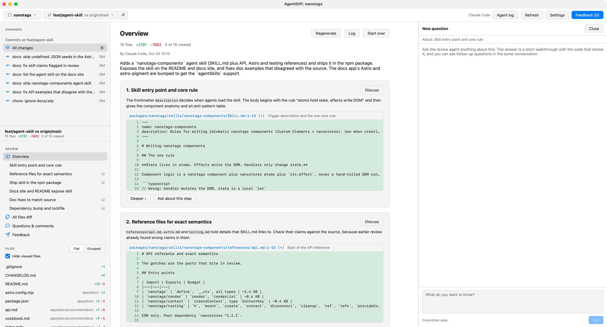

# agentdiff

A native macOS app for reviewing the code your coding agent wrote. You read a short walkthrough of the changes first and go deeper wherever you need to. Then you read the diff grouped by intent and hand a feedback file back to the agent.



## Install

You need macOS 12 or later, on Apple silicon or Intel. You also need at least one of the agent CLIs, installed and signed in:

- [Claude Code](https://docs.claude.com/en/docs/claude-code) (`claude`), tested with 2.1.310
- [Codex](https://github.com/openai/codex) (`codex`), tested with 0.162.1

1. Download `AgentDiff.dmg` from the [latest release](https://github.com/psd-coder/agentdiff/releases/latest).
2. Open the disk image and drag AgentDiff to Applications.
3. Open AgentDiff. The app is not notarized by Apple yet, so the first time macOS says that it cannot check the app. Close the message.
4. Open System Settings, go to Privacy & Security, and click Open Anyway next to AgentDiff. macOS remembers the choice, so later starts open the app at once.

To update, download the new release and replace the app in Applications. macOS asks again for each new version, so repeat steps 3 and 4.

If you prefer a terminal, this command installs or updates the app without the macOS warning, because `curl` does not mark the file as downloaded from the internet:

```bash
curl -fL -o /tmp/AgentDiff.dmg https://github.com/psd-coder/agentdiff/releases/latest/download/AgentDiff.dmg \
  && hdiutil attach -nobrowse -quiet -mountpoint /tmp/AgentDiff /tmp/AgentDiff.dmg \
  && rm -rf /Applications/AgentDiff.app \
  && cp -R /tmp/AgentDiff/AgentDiff.app /Applications/
hdiutil detach -quiet /tmp/AgentDiff
```

The app reads the `PATH` of your login shell (`$SHELL -l -i`), so it finds the CLIs when you start it from the Dock too. Settings shows the version of each CLI it found, or why it found none. Open a repository from the app with Cmd+O, or start the app on the repository you are in from a terminal:

```bash
open -n /Applications/AgentDiff.app --args "$PWD"
```

## Features

- **Walkthrough by your own agent**: Claude Code or Codex reads the changes through its CLI on your subscription. It writes a summary and 3 to 7 steps, each with up to two snippets cut from the real diff. A click on a snippet opens the file's diff at those lines.
- **Go deeper into any step**: Go deeper opens a new walkthrough of the step, one level closer to the code. Each level forks the agent session of the level above, so the agent keeps what it learned on the way down. When the overview is done, the app writes the deeper walkthrough of every step, 3 at a time, so Go deeper usually opens at once. Settings can turn this off.
- **Questions in the side panel**: a question about a step or a page opens a conversation next to the walkthrough, so you keep your place. The answers are short walkthroughs with snippets, follow-up questions go on in the same agent session, and every conversation stays listed under its step and on the Questions & comments page.
- **Checklist**: the walkthrough also answers your checklist in a sentence or two per question: data changes, UI changes, API changes, and the changes that are not beautiful and why.
- **Files grouped by intent**: the agent puts every changed file into a group, in the order you should read them. Without an explanation, files are grouped by directory.
- **Any scope**: uncommitted changes (untracked files included), any branch against any base without a checkout, a single commit of that branch, or a custom `from..to` range. The branch picker also opens other worktrees of the repository.
- **Comments anywhere**: click `+` in the gutter, select line numbers, comment on a whole file or on one part of the explanation.
- **Separate discussion threads**: the first question of a thread forks the agent session that wrote the explanation, so it starts with that context. Later questions go on in the thread's own session, and threads never mix.
- **Feedback for the agent**: one Markdown document with a `path:line (+)` heading per comment, the quoted code, and the agent's answers if you want them. Copy it, or save it and copy a prompt that points to the file.
- **Agent log**: every run of an agent CLI is logged, with the command line, the prompt, each tool call and its output, and how the run ended. Each run shows its context size, the tokens in its last request, as Claude Code does. Codex does not report the context size, so a Codex run shows the tokens it processed. Every request reads the whole conversation again, so this number is much larger. The run details list the processed tokens (input, cache read, cache write, output) and the cost at API prices that Claude reports. The panel shows the context its runs built up. A run that resumes or forks an earlier session, as a deeper walkthrough or a follow-up question does, starts with that session's context, so it counts only the context it added. When no run reports a context size, the panel shows the processed total. The log panel opens on the right, for all runs of the review, or for the overview, one walkthrough or one thread.
- **Read-only agents**: Codex runs in its `read-only` sandbox. Claude runs in `dontAsk` mode with an allow list of read commands (`git diff`, `git show`, `grep`, `cat` and a few more), so any other Bash call is refused.
- **Settings**: agent, model, effort, a model and effort for automatic runs, binary path, extra CLI arguments, checklist questions.
- **Your own shortcuts**: any command can get a shortcut in Settings, also the ones outside the menu bar, as Mark File as Viewed.
- **Native UI**: built with [MyGo](https://mygo.egoist.dev) in Go, drawn with Metal, no webview. The app bundle is 10.9 MB.

## Building from source

You need Go 1.27.3 or later and git, and the requirements from [Install](#install). The first build downloads MyGo through the `tool` line in `go.mod`.

```bash
go tool mygo build
```

It worked when `build/darwin-<arch>/` holds `AgentDiff.app` and a `.dmg`, with `arm64` or `amd64` for `<arch>`. Start the app on the repository you are in:

```bash
open -n build/darwin-arm64/AgentDiff.app --args "$PWD"
```

To release a version, set `version` in `mygo.json`, commit, and push a tag with the same version, as `v0.2.0`. The Release workflow builds one app for Apple silicon and Intel on a macOS runner. It fails when the tag and `version` differ. Then it publishes a GitHub release with `AgentDiff.dmg`.

During development, `go run . /path/to/repo` starts the app on a repository. Without an argument the app opens the current directory when that is a git repository, and shows a welcome screen otherwise. The welcome screen lists the recent projects, which you open with Up, Down and Return, as in the project list.

## Core concepts

An agent changes 40 files in ten minutes. A pull request lists them in path order, which scatters related changes across the list. You lose track of why each one exists. `agentdiff` asks the agent for a walkthrough first: the idea of the change in a few steps, each with the lines that show it. You go deeper only into the steps you doubt, and every level down is closer to the code. Then you read the files group by group and leave comments where you disagree.

The walkthrough also answers a checklist, by default these questions:

1. What data changes: schemas, storage, formats?
2. What UI changes, and how do I see them?
3. What architecture and API changes?
4. Which changes are not beautiful?
5. Which assumptions and rules force the non-beautiful changes?

A question about a step or about the whole walkthrough opens a conversation in the side panel, and each answer is a short walkthrough. A note for the coding agent is a thread, anchored to a line range, a file or a step. A thread's comments go into the feedback. With Ask agent, the review agent also answers in the thread. Every walkthrough and every thread is a conversation of its own, so three independent questions do not end up in one long chat.

It fits when you:

- let an agent work on its own and review the result afterwards
- review commits one by one after the agent made a series of them
- want to send the agent one list of fixes instead of a dozen chat messages

## Reviewing a change

1. Pick a project and a branch in the toolbar. The project picker lists the repositories you opened before, adds a new one, and removes one from the list after you confirm (its saved reviews stay). The branch picker lists the local and remote branches, and opens the worktree of a branch that is checked out in another worktree. The button next to it opens Compare, which picks another base for the branch or a custom range. Then pick a scope in the top part of the sidebar: Uncommitted changes (only for the checked-out branch), All changes of the branch since its base, or one of its commits. The list has every commit of the branch or range. It reads them 50 at a time, and reads the next ones when you scroll near the end of the list. The count next to All changes is the number of all commits. A branch review belongs to the branch: it stays the same after a checkout, and it opens too when you pick the branch while another one is checked out. The app reads the checked-out branch again when its window gets focus and on Refresh. Uncommitted changes have one review per repository, because they stay in the working tree when you check out another branch.
2. On the Overview page, click Explain changes with Claude Code (or Codex). The walkthrough appears when the agent is done, and the sidebar regroups the files. The Flat and Grouped switch above the files lists them by path instead, with each file's folder in small text under its name. Hide viewed files leaves the files you marked viewed out of the list, in both flat and grouped mode. A group leaves the list when all its files are viewed. The open file leaves the list too. Next and previous file follow the order the sidebar shows, so with viewed files hidden they only step through the files left to review. Stop cancels the run, and the overview you had before stays under a "Stopped" note. When the CLI is missing or fails, the overview shows its error output.
3. Read the steps. Click a snippet's `path:line` to see it in the diff. Go deeper on a step opens a deeper walkthrough on its own page. Ask about this step opens a conversation in the side panel, with the questions asked about that step before. Open as page shows a conversation full width. The breadcrumbs and the sidebar lead back up. After a click on a snippet or a link, Back above the page (Cmd+[) returns to where you were, at the same scroll place.
4. Open a group with Review group, or with its name in the sidebar, to read all its files one after the other, or open one file. The chevron next to a group's name shows and hides its files, as do Right and Left. Mark a file Viewed when you are done with it. Mark all as viewed on the group page marks every file of the group. All files diff under Review in the sidebar (Cmd+4) shows the diffs of every file of the scope on one page, in the order the sidebar lists them, with the group titles between them. On these pages, the chevron before a file's name folds its diff. A file folds when you mark it Viewed, and it unfolds when you take the mark off.
5. Comment: `+` in the gutter for one line, or click a line number and Shift+click another to select a range, then use `+` on a selected line or Comment on lines. Comment on file comments on the whole file. The thread opens on the right. Comment saves your note. Ask agent (Cmd+Enter) also sends it to the review agent. While the agent answers, Comment still works, and Ask agent is off until the answer ends or you press Stop.
6. Open Feedback in the toolbar. Copy feedback copies the Markdown. Save to file... saves it, by default into the repository's git directory, and copies a prompt such as `Read the code review feedback in /repo/.git/agentdiff-feedback.md and address each item.` Paste either one into your coding agent.

Feedback for two comments:

````markdown
# Code review feedback

Scope: the uncommitted changes in the working tree: ...

Lines are 1-based. (+) marks lines of the new version, (-) lines of the old version. Address each item, or explain why not.

## cache/cache.go:6 (+)
```
	return strings.ToLower(key)
```
Keep keys case-sensitive, callers rely on it.

## api/handler.go (file-level)
Return a typed error here.
````

To see what an agent did, click Agent log in the toolbar, or Log on the Overview page, on a deeper walkthrough or in a thread. Runs and their steps are collapsed until you click them. Each run lists its steps in order: Command (a shell command you can paste into a terminal), Prompt, Session started (model and permission mode), Tool call and Tool result, Assistant, Result with turns, time and tokens, and the exit status. Copy puts the readable log on the clipboard. Show file opens the raw log in Finder.

Uncheck In feedback in a thread to leave it out, or mark it Resolved. The feedback page has the checkboxes Include agent replies and Include resolved threads.

## Keyboard

| Keys | What it does |
| --- | --- |
| Cmd+[ and Cmd+], or the mouse's back and forward buttons | Back and forward through the pages you opened |
| Escape | Closes the side panel on top: a thread or question, then the agent log |
| Cmd+1, Cmd+2, Cmd+3, Cmd+4 | Overview, Questions & comments, Feedback, All files diff |
| Option+Cmd+Down, Option+Cmd+Up | Next and previous file, in review order |
| Cmd+Shift+C, Cmd+Shift+F | Move the keyboard focus to the list of changes or to the list of files. In the list of files it stays on the open file or group, or opens the first file |
| Cmd+0 | Moves the keyboard focus to the page: the arrows then scroll it, or move in the diff of a file |
| Cmd+L | Agent log |
| Cmd+R | Read the changes again |
| Cmd+Shift+P | Command palette: type part of a command's name and press Return to run it |
| Cmd+P | Opens the project list |
| Cmd+B | Opens the branch list |
| Cmd+Shift+B | Compare |
| Cmd+, | Settings |
| Cmd+Enter | Sends the question or comment you are typing |
| Down, Enter or Space on the project or branch button | Opens its list |
| Up, Down, Page Up, Page Down in a list | Move the highlight. Typing in the branch list filters it |
| Enter in a list | Opens the highlighted project or branch |
| Cmd+Enter in the branch list | Opens the worktree of the highlighted branch, when another worktree has it checked out |
| Cmd+Backspace or Delete in the project list | Removes the highlighted project from the list, after you confirm |

These are the default shortcuts. The menu bar lists them under File, View and Go. Help > Keyboard Shortcuts (Cmd+/) shows them all in a dialog, with the shortcuts you gave commands outside the menu bar.

The command palette lists the commands that apply where you are: the menu bar's commands, and the actions of the open page and side panel, as Mark File as Viewed on a file page or Resolve Thread while a thread is open. While the field is empty, the 5 commands you ran last from it come first. The buttons of the window, the menu bar and the palette run the same commands.

## Configuration

Settings has three tabs: Appearance, Agent and Shortcuts. Every change is saved as you make it, and Done or Escape closes the dialog.

Shortcuts lists every command with its shortcut. Click a shortcut and press the new keys, which must include Command or Control. Escape cancels. When another command has those keys, they move to the command you record, and the tab says which command lost them. The standard shortcuts of macOS, as Copy and Quit, and Cmd+Return and Cmd+Backspace stay as they are. A command outside the menu bar runs by its shortcut where it applies, also while you type in a field. A field keeps the keys it edits with: Command with A, C, X, V, Z or Y, with or without Shift, and Control with the letters that move the caret, as A, E and K. Reset gives one command its default back, and Reset all shortcuts gives all of them theirs. `config.json` keeps only the shortcuts you changed, so new defaults still reach you.

| Field | Default | Purpose |
| --- | --- | --- |
| Agent | Claude Code | Which CLI writes the explanation and answers threads |
| Model | CLI default | Passed as `--model` (Claude) or `-m` (Codex) |
| Effort | CLI default | Passed as `--effort` (Claude) or `-c model_reasoning_effort=` (Codex) |
| Model for automatic runs | same as Model | Used by the overview and the deeper walkthroughs written ahead |
| Effort for automatic runs | `low` | Used by the overview and the deeper walkthroughs written ahead |
| Binary | found on the login shell's `PATH` | Full path to the CLI, `~/` allowed |
| Extra arguments | none | Added to the CLI call, split at spaces |
| Checklist questions | the five questions above | What the overview answers under its walkthrough |

Automatic runs are the runs the app starts by itself: the overview and the deeper walkthroughs it writes ahead. Your questions, follow-ups, threads and a click on Go deeper use Model and Effort. Each run in the agent log shows the effort it ran at.

The app wraps your questions in the scope, the diffstat, the list of changed files, the walkthrough format and the grouping request, because it parses the answer. Overviews written before the walkthrough still show as they were. Regenerate turns one into a walkthrough. The overview, each walkthrough and each thread keep one session for each agent. After you switch agents, the next question goes on in the earlier session of the new agent. That session does not hold what the other agent answered in between. When the new agent has no session yet, the question starts a new one, with the thread's anchor and its earlier messages. Regenerate on a deeper walkthrough drops its sessions of every agent, because they hold the conversation about the old walkthrough.

Appearance sets the theme: System follows the light or dark appearance of macOS, and Light or Dark keeps the app in one of them.

Code theme colors code in diffs and in answers. You can choose GitHub, the default, or a popular VS Code theme: VS Code, One, Catppuccin, Solarized, Gruvbox, Rosé Pine, Night Owl, Ayu, Vitesse, Dracula, Monokai, Nord or Tokyo Night. A theme with light and dark colors follows the theme of the app and changes only the colors of the code. Dracula, Monokai, Nord and Tokyo Night have only dark colors, so they also paint the background of the code in their own color. The colors come from the VS Code themes, and the app has fewer kinds of tokens than VS Code, so the code can look a little different from VS Code.

The app saves everything under `~/Library/Application Support/AgentDiff/`.

| File | Holds |
| --- | --- |
| `config.json` | global settings, recent repositories, split or unified diff, flat or grouped file list, hidden viewed files, the commands you ran last from the command palette, the shortcuts you changed, the theme and the code theme |
| `reviews/<repo hash>/<scope>.json` | explanation, groups, threads, and viewed files of one scope. The hash is of the repository path, so a moved repository starts with empty reviews |
| `reviews/<repo hash>/<scope>.runs/<run>.jsonl` | the raw log of one agent run: the run's details on the first line, then one line per command, prompt, output line, stderr line and exit. `<run>.usage.json` next to it holds the tokens the run spent. Each review keeps its last 50 runs. The logs hold the file contents the agent read |

An overview remembers which changes it was written for, as a `git patch-id` of the diff. Line numbers and whitespace do not count in it, so the same changes have the same ID as uncommitted changes, as a commit, after an amend or after a rebase. When a scope opens without a review, it takes over a saved review written for the same changes. A review of uncommitted changes moves, so after you commit them the review is on the commit. A review of a commit or a branch is copied. A file is viewed in the review it takes over when you marked it viewed in either review. While an agent writes into the review of the scope or into the saved review, the scope keeps its review, and the next load after the run takes it over. An overview also keeps an ID for the changes of each file. When the changes of a scope differ from the ones its overview was written for, the overview and the deeper walkthroughs show a warning, because their code snippets can show the wrong lines. The warning counts the files that changed since, the ones that are no longer in the changes and the new ones. An overview written before file IDs compares the changed files with its groups instead. When none of the files of the uncommitted changes' overview is changed any more, as after a commit, a stash or a switch to other work, the review goes to an archive and the scope starts empty. The overview of the uncommitted changes lists the archived reviews under Earlier reviews, also while the current changes have a review of their own. A click opens an earlier review on its own page, read-only: its walkthroughs with the deeper ones and the answers to questions, its checklist, its groups and its comments. The page has Delete, Restore while the current changes have no review (a restored review stays, also after a relaunch, even when none of its files is changed), and Open commit when a commit now holds the changes of the review. When a commit holds them together with other changes, the patch IDs differ, so the page names a recent commit that changes all the files of the review and offers to move the review there, while that commit has no review of its own. An archived review comes back by itself when the same changes return to the working tree, as after `git stash pop`. The archive keeps the 20 latest reviews of a repository. While a review is written for the current changes, the app saves the lines of each code snippet into it, so the page of an archived review shows the code as it was. A review saved by an earlier version of the app shows only the file and the line numbers of its snippets. Start over deletes the review of the current scope and its run logs, after you confirm. Until you quit the app, that scope takes no saved review over.

## Commands

| Command | What it does |
| --- | --- |
| `go tool mygo dev` | Builds a development app and restarts it on every change. It opens the `agentdiff` repository itself |
| `go tool mygo build` | Builds `AgentDiff.app` and a `.dmg` into `build/darwin-arm64/` |
| `go test ./...` | Runs all tests, with no network and no agent calls |
| `AGENTDIFF_SNAPSHOTS=/tmp/snaps go test ./internal/app` | Also writes PNG screenshots of the main screens, rendered without a window, into an existing directory |
| `AGENTDIFF_E2E=claude go test -run TestEndToEnd -v ./internal/app` | Asks a real agent (`claude` or `codex`) to explain this repository's last commit, then asks a question in a forked session. It uses your subscription. `AGENTDIFF_E2E_MODEL` sets the model |

## Project layout

```
main.go                   picks the repository to open and starts the app
internal/app              window, app state, agent runs and streaming
internal/app/view*.go     one file per screen: overview, files, thread panel, feedback, settings
internal/gitx             git CLI wrapper: scopes, changed files, file contents, commits
internal/agent            claude and codex CLI runner: arguments, stream parsing, login-shell PATH
internal/review           review model, explanation prompt and parsing, feedback export
internal/store            JSON files for settings and reviews
```

Only the packages under `internal/` talk to git and the CLIs. Views never block: git and agent work runs on goroutines and reaches the view through `Window.Update`.

## FAQ

**Why a native app and not a page in the browser?**
MyGo's native UI ships a diff viewer with gutter buttons and room for comments under lines. Its Markdown view is built for streamed replies. The app starts at once and does not need a server.

**Why does the agent explain the changes instead of the app reading the diff itself?**
The agent can read the files around the change, the commit messages and the tests. It also sees the reasons behind a change that a diff does not show, which is what the questions about non-pretty changes ask for.

**Can the review agent change my code?**
Codex cannot: it runs in its `read-only` sandbox. Claude refuses every Bash call that matches neither the app's allow list nor an allow rule in your own Claude settings. So Claude can only write when your settings allow a write command. Your coding agent applies the feedback, in its own session.

**When should I not use it?**
For a two-line change: `git diff` is faster. `agentdiff` does not post to GitHub either. Review pull requests of other people in GitHub.

**What does it not do yet?**
Comments stay on the line numbers they were written on, so after the agent edits a file they can point at other code. The quoted code in the feedback shows what was meant. The app does not watch files: click Refresh (Cmd+R) after the agent changes something. The app is not single-instance: each `open -n` starts another copy with its own window.

## License

MIT
